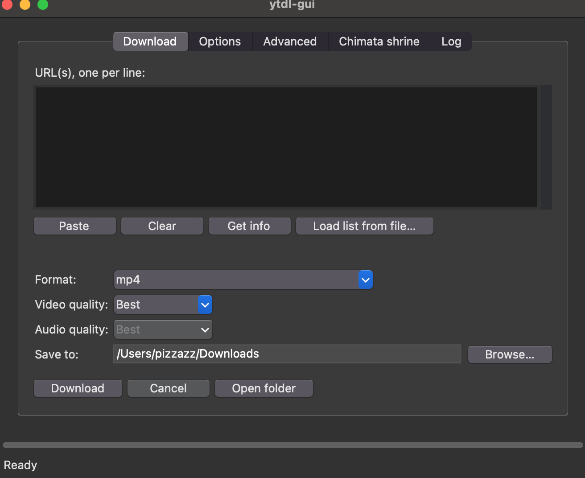

# youtube-downloader
ytdlp and ffmpeg with an ui
here's how it looks like

i made this for myself im sorry if it does not work for you


---
```
git clone https://github.com/ppopgun/youtube-downloader.git
cd youtube-downloader
```
requirements
```
python -m pip install -r requirements.txt

```
run

```
python3 ytdl.py

```
or

```
python ytdl.py

```
yt-dlp + ffmpeg updater


```
g++ -std=c++17 update_stuff.cpp -o update_stuff && ./update_stuff
# or
cl /std:c++17 /EHsc update_stuff.cpp && update_stuff.exe  

```
